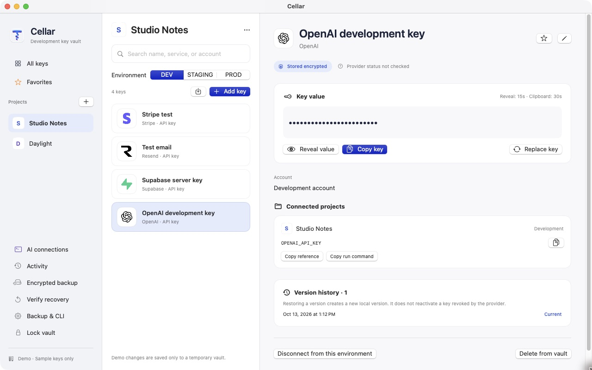
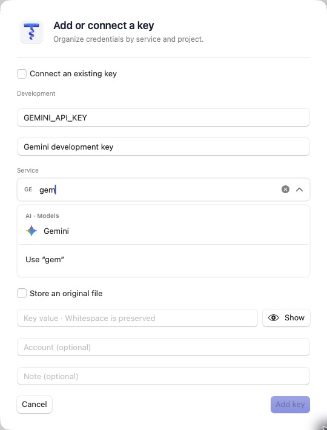

# Cellar

A local macOS vault for developers and their AI tools. Keep API keys, key-value pairs, JSON, text and original files organized by project, and let Codex, Claude and CLI tools use selected API keys, document fields and files through an approved local broker.

개인 개발자를 위한 macOS 로컬 비밀정보 금고입니다. API 키·키값 묶음·JSON·텍스트·파일을 암호화해 보관하고, Codex·Claude가 선택한 API 키·문서 필드를 채팅에 노출하지 않고 사용할 수 있습니다.

**[Download Cellar 0.7.21 beta](https://github.com/kohana-dev/keydesk/releases/download/v0.7.21/Cellar-0.7.21-macOS-arm64.zip)** · [Latest release](https://github.com/kohana-dev/keydesk/releases/latest) · [Installation guide / 설치 안내](docs/installation.md)

Apple Silicon · macOS 14+ · Developer ID signed and Apple notarized. Intel builds are not currently provided. End users do not need an Apple Developer account.



*Actual English interface. Screenshots use an isolated demo vault with fictional projects and credentials; no personal vault data is shown.*

## What you can do

- Close dialogs immediately with the fixed upper-right X. Close, Cancel and approval actions also remain visible in a fixed footer while scrolling settings, forms and request details.
- Check the latest official release from Settings, only when you choose to. Updates are downloaded and installed manually.
- Write a bug report, review the exact contents, then open a GitHub draft. App/OS details are optional; vaults, credentials, logs, and screenshots are not collected. You submit the public report yourself on GitHub.

- Choose English, 한국어, or the system language in **Cellar → Settings → App language**. The app applies changes immediately and remembers the choice; existing key names and project data stay unchanged.
- Organize credentials by project and Development / Staging / Production environment. Add your own project images.
- Find services with inline search recommendations and recognizable provider logos. The Weather & Environment category includes OpenWeather, WeatherAPI, Tomorrow.io, Visual Crossing, Weatherbit and AccuWeather, with Korean/English search aliases and automatic classification for clear environment variable prefixes. Weather services use a built-in system weather symbol.
- Choose API key, key-value pairs, JSON document, plain text or original file when adding an item. Key-value pairs have editable named fields; JSON is validated and formatted only when you choose to. JSON and text preserve the entered whitespace and line breaks. Text content is limited to 64 KiB in UTF-8; original files such as `.p8`, `.pem`, service-account JSON, `.p12` and `.jks` are limited to 1 MiB.
- Reveal and copy complete JSON, text or key-value content in the app. Editing an existing document requires Mac authentication. Choose an individual key-value or JSON field by JSON Pointer for CLI environment/stdin injection or supported API authentication. CLI fields can be strings, numbers or booleans; API authentication requires a nonempty string. The app builds commands from project references and field paths without revealing values. Whole documents are never injected automatically; original file injection remains available.
- Deposit a new key or file while locked; it is merged into the vault and backed up after unlocking.
- Use the macOS menu bar to reopen Cellar, lock/unlock, add a key or view pending approvals.
- Copy values with 30-second clipboard cleanup; revealed values hide after 15 seconds.
- Choose iCloud Drive, a Google Drive for desktop sync folder, or another folder for automatic encrypted backups. Google Drive sync completion is checked in Google Drive; the app verifies the saved encrypted file. The recovery key stays in iCloud Keychain when available or in your separate safekeeping.
- Use the signed CLI for SDKs, builds and original files, or MCP for supported provider API requests. View and revoke remembered approvals in the app.
- Choose **Allow all requests temporarily** in Settings or the menu bar for 1–480 minutes of automatic CLI, API and MCP approval across all projects and environments, including Production. Authenticate once to start, monitor the remaining time and stop immediately from Settings or the menu bar. Locking the vault or quitting also ends the session. Stopping or expiry lets already started work continue; lock and quit keep their existing cancellation behavior.



## Get started

1. Download the ZIP and `SHA256SUMS.txt` from the [release](https://github.com/kohana-dev/keydesk/releases/tag/v0.7.21), and verify the checksum.
2. Unzip and move **Cellar.app** to **`~/Applications`**. This is the installation path used by the AI connection scripts.
3. Open Cellar normally. Follow macOS authentication and check your encrypted backup status. For Google Drive, install and sign in to Drive for desktop first, then open **Manage → Settings → Choose backup location → Google Drive** and select its actual sync folder. Check upload completion in Google Drive.
4. In **Manage → Settings / 관리 → 설정**, connect the bundled CLI. Add an item and choose its format; select a project if you want to give it a project reference.
5. For Codex and Claude, follow the [AI connection steps](docs/installation.md#connect-codex-and-claude). One global MCP connection routes requests using each repository's names-only project manifest.

The app bundle and executable are **Cellar.app** and **Cellar**. The compatible CLI, MCP server and skill remain named **`keydesk`**. Existing vault paths and Keychain identity are unchanged. Upgrading from `Keydesk.app`? See the [migration steps](docs/installation.md#upgrade-from-keydeskapp).

Cellar 0.7.21 opens existing vaults. Saving key-value, JSON or text content uses vault format 3, including when that content remains only in version history. These vaults and their backups require Cellar 0.7.19 or later; older versions refuse to open them. Update every Mac and use the matching bundled helper before sharing an updated backup. Field selection requires both Cellar and its bundled helper at version 0.7.20 or later; older apps are rejected before a selected-field request is sent.

Google Drive backups use the same encrypted `.keydesk` format; Cellar does not upload a plaintext recovery key or connect to your Google account. Keep the recovery key separately. See [backup selection and recovery](docs/installation.md#backup-location-and-recovery--백업-위치와-복원) for setup and manual recovery.

## Use credentials without putting them in chat

```sh
# Let the CLI import a key directly; do not read the env file into AI output.
keydesk store --project my-app --env dev --name OPENAI_API_KEY --from-env-file /absolute/path/.env

# Give a development tool only the selected variable.
keydesk run --project my-app --env dev --only OPENAI_API_KEY -- npm run dev

# Select only two fields from a bound JSON or key-value document.
keydesk run --project my-app --env dev --select 'DB_PASSWORD=DB_CONFIG#/password' --select 'PORT=DB_CONFIG#/database/port' -- /absolute/path/to/tool

# Authenticate an official provider request with one nested string field.
keydesk request --project my-app --env dev --key SERVICE_CONFIG --field /openai/token --provider OpenAI --method GET --url https://api.openai.com/v1/models

# Request weather without placing the key in a URL or command argument.
keydesk request --project my-app --env dev --key OPENWEATHER_API_KEY --method GET --url 'https://api.openweathermap.org/data/2.5/weather?lat=37.57&lon=126.98&units=metric'

# Store an original file, then pass a private temporary file path to its tool.
keydesk store-file --project my-app --env dev --name GOOGLE_APPLICATION_CREDENTIALS --from-file /absolute/path/service-account.json
keydesk run --project my-app --env dev --files GOOGLE_APPLICATION_CREDENTIALS -- /absolute/path/to/tool
```

For direct API calls, the local broker injects an API-key item or explicitly selected key-value/JSON string field internally. Field paths use RFC 6901 JSON Pointer: `/database/password`, `/tokens/0`, `/a~1b` for a key containing `/`, and `/~0` for a key containing `~`. Empty `--field ''` selects a scalar JSON root. Missing fields, nulls, objects and arrays are rejected. Use `--stdin-key OUTPUT` with a CLI selection to deliver that field only through stdin. Text documents remain app-only content. MCP exposes `project_context` and `request_http` through the global router; there is no credential-reading tool. Supported provider requests include Gemini, OpenAI, Anthropic, Cloudflare, Paddle and RevenueCat. Cellar 0.7.21 also supports read-only GET requests for OpenWeather, WeatherAPI, Tomorrow.io, Visual Crossing, Weatherbit and AccuWeather. Leave authentication parameters out of caller URLs: the broker injects the provider-specific header or query authentication internally; it rejects caller-supplied authentication query parameters on weather requests. See [API broker](docs/local-api-broker.md), [MCP setup](docs/mcp-setup.md) and [project CLI](docs/project-cli.md).

By default, initial use requires human approval. Exact development commands can be remembered for 30 minutes. Production reuse is optional, lasts five minutes and allows ten additional starts/requests. Requests must match exactly, including selected field paths and CLI output names; lock, key changes and quitting revoke remembered approvals. API requests in dev/staging have a separate 30-minute / 100-repeat limit. An explicitly started temporary all-request session replaces these per-request prompts until it ends. It does not bypass project/key matching, supported API targets or executable validation, and cannot be started by the CLI or AI.

`stored` confirms a vault save; verify backup upload separately. `queued` means encrypted on this Mac only until unlock, merge and successful backup. Source env/key files are preserved. Original files are limited to 1 MiB each; selected temporary files are cleaned up on exit, cancellation or vault lock. Intentional `--keep-running` retains injected credentials/files until the process ends.

## Build and security

SwiftUI, CryptoKit and Security; no external Swift package dependencies.

```sh
swift test
KEYDESK_SIGNING_MODE=adhoc ./scripts/build-app.sh
open dist/Cellar.app --args --demo
```

Ad-hoc builds are for demos, not real protected vaults. See [source builds and signing](docs/open-source-building.md).

Cellar is a beta, not an independently audited credential manager. Same-Mac encrypted backup recovery has been verified; restore on a separate Mac has not. Keep an independent encrypted backup and recovery key. Approved SDK/build tools receive raw credentials and can read or transmit them; output masking is not a sandbox. Deleting a local key does not revoke its provider credential or remove old backups. Read [SECURITY.md](SECURITY.md) and [verification limits](docs/open-source-readiness.md).

## Contributing and license

[Contributing](CONTRIBUTING.md) · [Security reports](SECURITY.md) · [Third-party notices](THIRD_PARTY_NOTICES.md)

Cellar code is [MIT licensed](LICENSE). Provider artwork retains its own licenses and trademarks. Never include actual credentials, private key files or vault backups in issues or pull requests.
