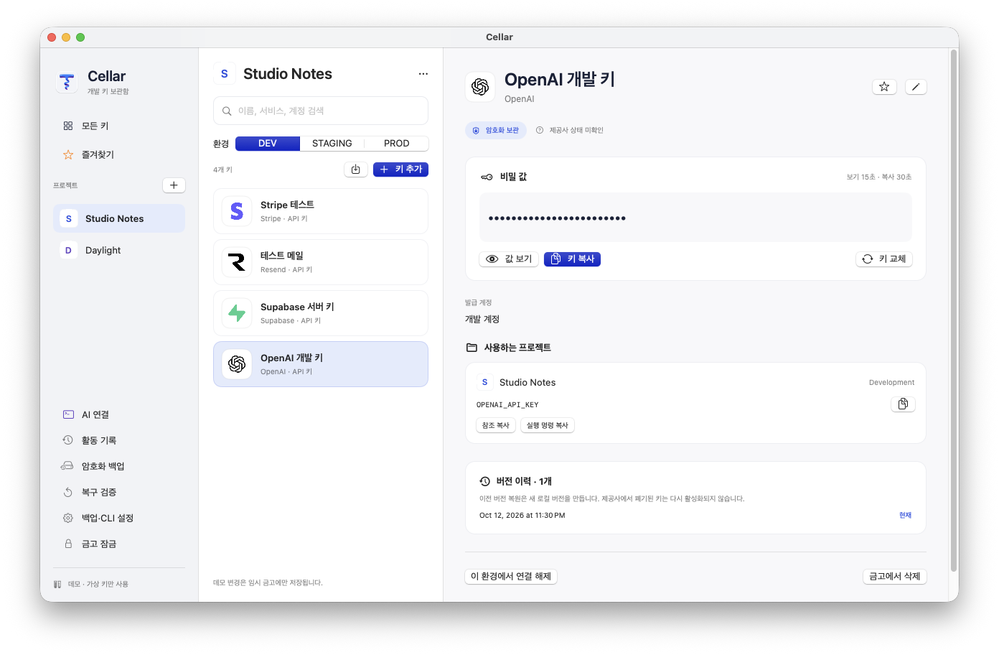

# Install Cellar / Cellar 설치 안내

Cellar 0.7.18 gives projects more space in the sidebar. Open **Manage** at the bottom for AI connections, activity, encrypted backup export, recovery verification, and settings. Lock stays one click away. Routine backup status lives in the menu; warnings remain visible. / 0.7.18은 사이드바를 프로젝트 탐색 중심으로 정리합니다. 하단 **관리**에서 AI 연결, 활동 기록, 암호화 백업 내보내기, 복구 검증, 설정을 열 수 있으며 잠금 버튼은 바로 사용할 수 있습니다. 일반 백업 상태는 메뉴에서 확인하고, 주의가 필요한 상태는 계속 표시합니다.

Cellar 0.7.19 adds API key, key-value pairs, JSON document, plain text and original file formats. Existing vaults still open. After saving key-value, JSON or text content, the vault and its backups require Cellar 0.7.19 or later, even if that content remains only in version history. Older versions refuse the updated format. / 0.7.19는 API 키·키값 묶음·JSON·일반 텍스트·파일 형식을 지원합니다. 기존 금고도 열 수 있습니다. 키값 묶음·JSON·텍스트를 저장하면 이력이 남아 있는 경우까지 금고와 백업에 0.7.19 이상이 필요하며 이전 버전은 열기를 거부합니다.

The official app is **Cellar.app**, with a **Cellar** executable. The `keydesk` CLI, MCP server and companion skill names stay compatible with earlier installations.

## Requirements

- Apple Silicon Mac with macOS 14 or later. The current release does not include Intel binaries.
- No Apple Developer membership is required to install the official signed, notarized app.
- For iCloud backup and recovery: the same Apple account, iCloud Drive and iCloud Keychain enabled. Check upload status; choosing an iCloud folder alone does not prove the file has uploaded.
- For optional Google Drive backups: install [Google Drive for desktop](https://support.google.com/drive/answer/10838124?hl=en), sign in to your account, and select an actual synced folder in Cellar. Drive for desktop handles uploads; Cellar does not sign in to Google or use the Drive API.
- For AI setup: Git, Python 3.11+, the selected AI CLI(s) installed (both for the default recipe). Sign in to each selected AI client before asking it to work. The app itself does not require Git or Python.
- Official setup references: [Python for macOS](https://www.python.org/downloads/macos/), [Git for macOS](https://git-scm.com/downloads/mac), [Codex CLI](https://developers.openai.com/codex/cli/) and [Claude Code setup](https://code.claude.com/docs/en/setup).

## App language / 앱 언어

Cellar 0.7.7 supports English and 한국어. Open **Cellar → Settings → App language**
and select **System**, **한국어**, or **English**. The interface changes immediately
and the choice is remembered after restarting. Your saved project names, key names,
and vault contents are preserved. Settings are available while the vault is locked.

Cellar 0.7.7부터 한국어와 영어를 지원합니다. **Cellar → 설정 → 앱 언어**에서
**시스템 설정**, **한국어**, **English**를 선택하세요. 변경은 바로 적용되며,
다시 실행해도 유지됩니다. 저장한 프로젝트·키 이름과 금고 내용은 유지됩니다.
금고를 잠근 상태에서도 설정을 열 수 있습니다.

## Launch at login / 로그인 시 자동 실행

In Cellar 0.7.12 or later, open **Cellar → Settings** (⌘,) and turn **Launch at login** on or off. This changes the macOS login item registration and is available while the vault is locked. Cellar reads the current macOS setting; it does not turn the option back on after you disable it in System Settings. If macOS requires approval, use the **Open Login Items Settings** button and allow Cellar there. Starting the app at login keeps the vault locked until you authenticate.

Cellar 0.7.12부터 **Cellar → 설정**(⌘,)에서 **로그인 시 자동 실행**을 켜거나 끌 수 있습니다. macOS의 실제 로그인 항목 등록을 변경하며 금고가 잠겨 있어도 설정할 수 있습니다. 시스템 설정에서 꺼둔 항목을 앱이 임의로 다시 켜지 않습니다. macOS 승인이 필요하다고 표시되면 **로그인 항목 설정 열기**에서 Cellar를 허용하세요. 로그인할 때 앱이 실행되어도 금고는 인증 전까지 잠겨 있습니다.

## Allow all requests temporarily / 일정 시간 모든 요청 허용

Open **Cellar → Settings → Allow all requests temporarily** after unlocking the vault. Choose 15, 30, 60 or 120 minutes, or enter a custom duration from 1 to 480 minutes, then start. Authenticate once on your Mac. All projects and Development, Staging and **Production** environments are included: CLI runs, supported API requests and MCP key-name lookups no longer require individual approval during the session. A request already waiting for approval is included, too.

In Cellar 0.7.15 or later, click the Cellar menu-bar icon and choose **Allow all requests temporarily** to start for 15, 30, 60 or 120 minutes directly. **Custom…** opens a compact control window where you can enter 1–480 minutes. Starting still requires one Mac authentication. The same menu shows the active session and **Stop automatic approval now**.

Settings, **AI connections → Approval status** and the menu bar show the active session and remaining time. Use **Stop now** to end it immediately. Expiry, vault lock, screen lock, sleep or quitting also ends it. The session is kept only in memory and stays off after restarting or unlocking. Ending it clears remembered permissions and returns subsequent requests to individual approval; stopping or expiry does not cancel already accepted work. Vault lock and quitting retain their existing cancellation behavior, including CLI `--keep-running` when locking.

Project/key mappings, supported API hosts, request validation and executable identity checks still apply. Unsupported or invalid requests remain rejected. The CLI and AI cannot enable or extend this setting. Manual operations such as unlocking, showing a recovery key or rotating vault keys keep their existing authentication.

금고를 연 뒤 **Cellar → 설정 → 일정 시간 모든 요청 허용**에서 15·30·60·120분을 고르거나 1~480분을 직접 입력하고 시작하세요. 시작할 때 한 번 Mac 인증을 받습니다. 모든 프로젝트의 개발·스테이징·**운영 환경**에 적용되며, 해당 시간 동안 CLI 실행·지원 API 호출·MCP 키 이름 조회를 개별 승인 없이 처리합니다. 이미 승인 대기 중인 요청도 포함합니다.

0.7.15부터 메뉴 막대의 Cellar 아이콘에서 **일정 시간 모든 요청 허용**을 선택하면 15·30·60·120분 동안 바로 시작할 수 있습니다. **직접 입력…**은 1~480분을 입력할 수 있는 작은 제어 창을 엽니다. 시작할 때 Mac 인증은 한 번 필요합니다. 같은 메뉴의 **자동 허용 지금 중지**로 바로 끌 수 있습니다.

설정, **AI 연결 → 승인 상태**, 메뉴 막대에서 활성 상태와 남은 시간을 확인하고 **지금 중지**로 즉시 끌 수 있습니다. 시간 만료·금고 잠금·화면 잠금·잠자기·앱 종료 시에도 해제됩니다. 메모리에만 유지하므로 다시 실행하거나 금고를 열어도 자동으로 켜지지 않습니다. 해제하면 기억한 허가도 지우고 이후 요청을 다시 개별 승인합니다. 중지나 시간 만료 전에 시작한 작업은 자동 취소하지 않습니다. 금고 잠금과 앱 종료의 기존 작업 종료 동작 및 잠금 시 CLI의 `--keep-running` 동작은 유지됩니다.

프로젝트·키 연결, 지원 API 주소, 요청 형식과 실행 파일 검증은 계속 적용됩니다. CLI나 AI는 이 설정을 켜거나 시간을 연장할 수 없습니다. 금고 열기·복구 키 보기·금고 키 교체 같은 직접 조작의 기존 인증은 유지됩니다.

## Caps Lock state / Caps Lock 상태

Cellar 0.7.13 shows **Caps Lock is on / off** below **Unlock vault** and below a focused secret or recovery-key input. The display updates while the view is visible. The Mac password dialog is provided by macOS; Cellar cannot insert a custom indicator inside that system-owned input field. Check the state on Cellar’s lock screen before opening authentication. Cellar reads only the Caps Lock modifier state, never your Mac password or typed characters.

Cellar 0.7.13은 **금고 열기** 아래와 선택한 비밀값·복구 키 입력란 아래에 **Caps Lock 켜짐 / 꺼짐**을 표시합니다. 화면이 보이는 동안 상태를 계속 갱신합니다. Mac 비밀번호 인증창은 macOS가 제공하므로 그 입력칸 안쪽에는 앱의 표시를 넣을 수 없습니다. 인증을 열기 전에 Cellar 잠금 화면에서 상태를 확인하세요. Caps Lock 상태만 읽으며 Mac 비밀번호나 입력한 문자를 수집하지 않습니다.

## Updates and bug reports / 업데이트와 버그 제보

Cellar 0.7.8 adds these controls to **Cellar → Settings** (⌘,). They are
available while locked. **Check for updates** reads only the official public
GitHub release when clicked; it never sends vault contents or installs an update.
If a newer release is available, open its official download page, verify its
checksum, quit Cellar, and replace the app in `~/Applications`.

**Write a bug report** collects only what you type. App version/build, macOS
version, and architecture are optional and visible before inclusion. Review
the exact title/body, confirm that it contains no secrets or personal data, and
choose **Open GitHub draft**. This immediately passes the reviewed content to
GitHub in the browser URL, before public submission. Browser history or browser
sync may retain that URL.
Sign in and submit it yourself on GitHub to publish it. No report is posted
automatically, and logs, screenshots, key values, project names and paths are
never attached. Common secret patterns are blocked locally, but you must check
the full report. Security vulnerabilities use the separate private report link.
Sentry and automatic crash/analytics collection are not included.

Cellar 0.7.9 adds the [privacy policy](https://www.kohanacloud.com/cellar/en/privacy)
and [terms of use](https://www.kohanacloud.com/cellar/en/terms) to Settings and the
privacy policy to the report composer and review screen.

0.7.8의 **Cellar → 설정**(⌘,)에서 **업데이트 확인** 또는 **버그 제보 작성**을
선택하세요. 금고가 잠겨 있어도 사용할 수 있습니다. 업데이트는 버튼을 누를
때만 확인하고, 새 버전은 체크섬 확인 후 직접 앱을 교체합니다. 버그 제보는
작성 → 전체 내용 검토 → 비밀정보·개인 정보 없음 확인 → GitHub 초안 열기
순서입니다. 초안을 여는 즉시 검토한 내용이 URL로 GitHub에 전달되며, 브라우저
방문 기록이나 동기화에 남을 수 있습니다. GitHub에서 직접 제출해야 공개됩니다. 앱·OS 정보는 선택 사항이며
키·금고·로그·스크린샷은 자동 첨부하지 않습니다. 보안 문제는 비공개 제보를
사용하세요.

0.7.9 설정에서 [개인정보 처리방침](https://www.kohanacloud.com/cellar/privacy)과
[이용약관](https://www.kohanacloud.com/cellar/terms)을 확인할 수 있습니다.

## Download and install

1. Open the [latest release](https://github.com/kohana-dev/keydesk/releases/latest). Download its `Cellar-<version>-macOS-arm64.zip` and `SHA256SUMS.txt` into the same folder.
2. Verify the checksum in that download folder:

   ```sh
   shasum -a 256 -c SHA256SUMS.txt
   ```

   Continue only when the ZIP reports `OK`.
3. Unzip and move **Cellar.app** into your user Applications folder, **`~/Applications`**. In Finder, choose **Go → Go to Folder** and enter `~/Applications`; create the folder if needed. The AI installers currently expect this location. `/Applications` can run the app, but is not the path used by these setup scripts.
4. Open Cellar normally. On first launch, choose to create a new vault or restore a backup; if an iCloud backup is found, choose that copy or a newer file from another location. Follow macOS authentication when prompted. Do not bypass Gatekeeper warnings.
5. Open **Manage** to check the backup status; warnings also appear in the sidebar. If cloud backup is unavailable, choose an encrypted backup location and keep the recovery key independently. A local backup is not an uploaded backup.
6. Open **관리 → 설정** and connect the bundled CLI to `~/.local/bin/keydesk`. Confirm the connection without exposing credentials:

   ```sh
   ~/.local/bin/keydesk status
   ```

Cellar creates the initial vault through its first-run flow. After unlocking, add a secret and choose **API key**, **Key-value**, **JSON**, **Text** or **File**. Key-value rows support adding/removing fields and reject duplicate names. JSON is validated while editing; **Format JSON** changes formatting only when explicitly clicked. JSON and text otherwise retain the original whitespace and line breaks. Text content is limited to 64 KiB in UTF-8, and original files to 1 MiB. The service field offers inline suggestions and is optional for document/file formats. Account and notes are under the optional details disclosure.

To organize an item by project, choose a project and Development, Staging or Production, then enter its variable/reference name. You can also connect an existing item. API-key references support CLI environment/stdin injection and broker authentication; file references retain original-file injection. In Cellar 0.7.20, a known key-value/JSON leaf can be selected with `run --select 'OUTPUT=SOURCE#/pointer'`, including a selected output as `--stdin-key`, or used for broker authentication with `request --key SOURCE --field /pointer --provider OpenAI`. CLI fields accept strings/numbers/booleans; API fields must be strings. Whole documents, null/containers and text are not injected. Other-classified documents require a supported provider; classified documents must match their saved provider. Selectors use RFC 6901 and do not list/read fields to the AI. See [project CLI](project-cli.md) and [API broker](local-api-broker.md). Copying key-value content in the app still copies the complete JSON object.

Cellar 0.7.21 adds weather services **OpenWeather**, **WeatherAPI**, **Tomorrow.io**, **Visual Crossing**, **Weatherbit** and **AccuWeather**. Choose the matching service when storing the API key; a known JSON/key-value string field can use the same provider for direct API requests. The weather broker accepts GET without a body on official hosts. Put only location/options in the request URL and let the app insert authentication; do not add API-key query parameters or placeholders. Provider account/plan restrictions still apply. See [API broker](local-api-broker.md) for examples and supported hosts.

Editing an existing document first requires Mac authentication. Revealed saved content hides after 15 seconds and when focus is lost; copies use 30-second clipboard cleanup. JSON/text draft editors also hide when the app loses focus; choose **Show and edit** to continue. Cancelling or closing the form discards its drafts.

**비밀 항목 추가**에서 API 키·키값·JSON·텍스트·파일 형식을 고르세요. 키값은 행 단위로 추가·삭제하고 중복 이름을 검사합니다. JSON은 문법을 검사하며 **JSON 정렬**을 눌러야 서식이 바뀝니다. JSON·텍스트의 공백과 줄바꿈은 그대로 보관합니다. 텍스트 내용은 UTF-8 기준 64 KiB, 원본 파일은 1 MiB까지 지원합니다. 기존 문서 편집에는 Mac 인증이 필요합니다. 키값·JSON은 0.7.20부터 `--select '출력변수=참조이름#/필드경로'`로 필요한 값만 CLI 환경변수·표준입력에 전달할 수 있습니다. API 요청은 `--field /필드경로`와 필요한 `--provider`를 사용하며 문자열만 허용합니다. 전체 문서나 텍스트는 자동 전달되지 않습니다. 필드 경로는 사용자가 지정하거나 기존 프로젝트 문서에서 확인하고, AI에 값을 출력해 찾지 않습니다. 앱에서 키값을 복사하면 전체 JSON이 복사됩니다.

0.7.21부터 OpenWeather·WeatherAPI·Tomorrow.io·Visual Crossing·Weatherbit·AccuWeather를 서비스로 선택할 수 있습니다. 공식 호스트로 GET 날씨 요청을 보내며 본문은 사용하지 않습니다. URL에는 위치·단위 등 공개 옵션만 넣고 인증 키나 키 자리표시자는 넣지 마세요. 앱이 저장된 키 또는 선택한 문자열 필드를 인증에 사용합니다.



잠금 중에도 **새 키 맡기기**로 새 키나 파일을 암호화 접수할 수 있습니다. 다음 잠금 해제 때 금고에 편입되고 백업됩니다. 접수 직후에는 이 Mac에만 저장된 상태이므로 클라우드 업로드가 끝났다고 간주하지 마세요.

## Backup location and recovery / 백업 위치와 복원

Open **Manage → Settings → Choose backup location** and choose **iCloud Drive**,
**Google Drive**, or **Other folder / external disk…**. Your existing iCloud backup setting stays
in place until you select a different location.

For Google Drive:

1. Install Drive for desktop and sign in before choosing the backup location.
   On macOS, enable Google Drive in Finder if prompted. See Google's
   [macOS instructions](https://support.google.com/drive/answer/12178485?hl=en).
2. In Cellar, choose **Manage → Settings → Choose backup location → Google Drive**.
   Select a folder that Drive for desktop actually syncs. A private folder such
   as **My Drive/CellarBackups** keeps backups separate from other files. A folder
   named “Google Drive” is not automatically synced; mirrored folders can also
   be stored at a custom location.
3. Cellar writes and verifies the encrypted `.keydesk` backup in that folder.
   This confirms file storage, not upload completion. Check **Sync status** in
   Google Drive for desktop and resolve any paused sync, account, storage, or
   upload errors there. Keep cloud sync enabled until the backup has uploaded.
4. For reliable local access to streamed backups, make the backup folder
   **Available offline** in Finder. This also applies to new files in that folder;
   see Google's [offline instructions](https://support.google.com/drive/answer/2375012?hl=en).

The recovery key is still stored in **iCloud Keychain**, when available, and can
be viewed from **Manage → Settings → Show recovery key** after authentication. Keep a
separate safe copy when iCloud Keychain is unavailable or for an independent
recovery route. Cellar does not put a plaintext recovery key in Google Drive.

Google Drive recovery is manual: download the required `.keydesk` backup and
keep its matching recovery key ready. On a Mac or user account without an
existing Cellar vault, use **Restore encrypted backup file**, choose that downloaded
file, and enter the recovery key. An existing vault is preserved; use **Verify
backup recovery** there to check the file and key without replacing it. After
restoring a Google Drive backup, automatic backup is unconfigured until you
select this Mac's sync folder again in **Manage → Settings**. The old Mac's saved path
and folder access are not reused. Actual Google account sync and recovery on a
separate Mac have not been verified by the local tests.

**관리 → 설정 → 백업 위치 선택**에서 **iCloud Drive**, **Google Drive** 또는
**다른 폴더 / 외장 디스크…**를 선택하세요. Google Drive를 쓰려면 먼저 Drive for desktop을
설치하고 로그인한 뒤 실제 동기화되는 폴더를 선택하세요. 예를 들어 내 드라이브의
비공유 **CellarBackups** 폴더를 사용할 수 있습니다. 앱의 저장·검증 성공은
업로드 완료를 뜻하지 않으므로 Google Drive의 **동기화 상태**를 확인하세요.
스트리밍 폴더는 Finder에서 **오프라인 사용 가능**으로 지정할 수 있습니다.

복구 키는 계속 iCloud 키체인 또는 사용자의 별도 보관 경로를 사용하며, 앱이
평문 복구 키를 Google Drive에 저장하지 않습니다. 수동 복원은 내려받은
`.keydesk` 파일과 해당 복구 키로 **암호화 백업 파일 복원**에서 진행합니다. 기존
금고가 있으면 덮어쓰지 않고 **백업 복구 검증**으로 확인할 수 있습니다.
Google Drive 백업을 복원한 뒤에는 이 Mac의 동기화 폴더를 다시 선택해야 자동
백업이 재개됩니다. 실제 Google 계정의 동기화와 다른 Mac 복원은 별도 검증이
필요합니다.

## Connect Codex and Claude

Install the official app first and connect its CLI. Before running the two-client recipe, confirm the prerequisites in Terminal:

```sh
python3 --version   # must be 3.11 or newer
git --version
codex --version
claude --version
```

If a command is missing, install it from the official references above, then reopen Terminal. A system Python older than 3.11 cannot run these scripts. Both AI clients are required by the default recipe below; single-client commands are shown after it. Close other client sessions while changing their configuration.

Clone the source repository to obtain the maintained setup scripts; you do not need to build the app:

```sh
git clone https://github.com/kohana-dev/keydesk.git
cd keydesk
python3 scripts/install-ai-skills.py
python3 scripts/install-auto-mcp.py
```

For only one client, use the same selection for both commands:

```sh
python3 scripts/install-ai-skills.py --client codex
python3 scripts/install-auto-mcp.py --client codex
# For Claude only, replace codex with claude.
```

Before writing, the installers check all selected targets, conflicting definitions, configuration syntax/structure and required source files. MCP setup also checks the installed Cellar helper, CLI link and selected client executables (`--version`). This does not authenticate an AI account or verify a provider key. A missing or unresponsive client stops setup before configuration writes.

On a handled installation error or keyboard interrupt, each script restores the files it changed (including prior permissions) and removes newly created target files. Existing replaced files also have private `.cellar-backup-<timestamp>` copies. The two commands are separate transactions: if MCP setup fails, successfully installed skills remain and can be reused. Correct the reported prerequisite and rerun; successful reruns are idempotent. Never delete an existing conflicting client configuration to get past an error.

Atomic writes protect individual files, but power loss or forcibly killing the installer can interrupt a multi-file setup. If rollback itself reports failure, restore the affected configuration from its backup before retrying. Do not run multiple installers or edit client configuration concurrently.

The scripts install the `keydesk` companion skill, update existing `cellar` aliases under the selected clients and existing `.agents/skills` Cellar aliases, and install one global repository-aware MCP connection for both clients. Other skills and their settings are preserved. They preserve unrelated client settings and stop on conflicting existing definitions. Restart/reload existing client sessions once to load the new connection. Explicit skill invocation remains Codex `$keydesk` and Claude `/keydesk`; an existing `$cellar` or `/cellar` alias keeps its name. After upgrading the app to 0.7.21, run `install-ai-skills.py --update` and reload existing MCP sessions for the current field-selection and weather provider schema.

Confirm the connection before creating a project mapping:

```sh
codex mcp list
claude mcp list
```

Codex should list `keydesk` as enabled; Claude should show `keydesk` as Connected. An Unsupported OAuth auth column in Codex is expected for this local stdio server: Cellar handles vault authentication and human approval separately.

No MCP registration is required for each project. In the repository you are developing, use a names-only `keydesk.project.json` that matches a project and variables already stored in Cellar:

```json
{
  "version": 1,
  "project": "my-app",
  "bindings": {
    "dev": {
      "OPENAI_API_KEY": "value",
      "GOOGLE_APPLICATION_CREDENTIALS": "file"
    }
  }
}
```

Create this file in the root of your actual development repository, replacing `my-app` and the example variables with the exact project and variable names you registered in Cellar. `dev`, `staging` and `prod` are environment identifiers; `Development` is the UI label for `dev`.

This file contains names and types only. It does not create, copy or expose keys. The AI should call `project_context` with its repository's absolute path, then `request_http` with the intended environment and an existing API-key binding, or a known `field` path from a key-value/JSON binding. Manifest kinds are `value` (legacy), `apiKey`, `keyValue`, `json`, `text` and `file`. The signed app validates actual saved format; metadata cannot override it. Original files, SDKs and build tools use `keydesk run --files/--only/--select`; no MCP value-reading, file-reading or document-field enumeration tool is added. See [MCP setup](mcp-setup.md), [local API broker](local-api-broker.md) and [project CLI](project-cli.md).

Approve the first use in Cellar yourself. If you choose exact-request reuse, identical production requests can share the grant across Codex and Claude for five minutes and ten additional requests. The app never gives the authentication value to the MCP caller. Approved CLI/SDK processes do receive their selected credentials and require trusted tools.

### First AI connection check

Start a new Codex or Claude session in that development repository and ask:

> Use the keydesk MCP project_context tool for this repository. Confirm the project, environment and variable names only. Do not read any credential values or call a provider API yet.

The response should match your manifest. If it reports `unconfigured`, fix the manifest instead of registering another MCP server. Then request your intended supported API operation and approve it in Cellar; success is an actual provider response, not merely a listed MCP server.

### If `keydesk` is not found in Terminal

The CLI link is `~/.local/bin/keydesk`. The full-path status command above works even if this folder is not in your shell PATH. For commands using bare `keydesk`, add it for the current Terminal session:

```sh
export PATH="$HOME/.local/bin:$PATH"
keydesk status
```

To keep it for future zsh sessions, add that same export line to your existing `~/.zshrc`; preserve its other contents. The AI adapters use the full helper path and do not need this PATH change.

## Upgrade from Keydesk.app

Keep your encrypted backup and recovery key. Do not delete the vault or change the app's signing identity as part of a rename.

1. Save or cancel any open registration form, then quit the old app.
2. Install the official **Cellar.app** in `~/Applications`. Remove the old `Keydesk.app` from Applications after confirming the new app works; keep a previous copy elsewhere if desired.
3. From the source checkout, update the CLI link and exact legacy client helper paths:

   ```sh
   python3 scripts/migrate-cellar-paths.py
   python3 scripts/install-ai-skills.py --update
   python3 scripts/install-auto-mcp.py
   ```

   Existing client settings and skills are backed up before changes. For a project-local MCP configuration add `--config /absolute/path/.mcp.json` to the migration command. Conflicting non-Cellar executables/configurations are preserved.
4. Restart AI sessions that cached the old direct helper path. A global router still uses the same `keydesk` MCP name.
5. Open Cellar and authenticate. Confirm your existing projects and backup status, then run `keydesk status`.
6. If a fixed Dock icon still shows Keydesk, remove that old Dock item and drag `Cellar.app` from Finder into the Dock.

Existing vault locations, project manifests and Keychain access identity remain unchanged. Renaming the app does not migrate data to a different vault.

## Troubleshooting

- **CLI cannot connect:** open `~/Applications/Cellar.app`; check the CLI link in **관리 → 설정**. Unlock only when the operation needs an existing credential.
- **AI cannot see MCP tools:** reload the session after setup and check the client's `keydesk` MCP connection. Do not fall back to reading `.env` or private key contents.
- **Project is unconfigured:** fix the repository's names-only manifest. Do not select another project's production credential based on its provider.
- **Approval expired or was rejected:** stop that attempt. Start a new request only when the user is ready; do not automatically retry.
- **Backup is pending:** keep Cellar open and check the selected backup folder. For iCloud, check the app's upload status and Apple account availability; for Google Drive, check Drive for desktop's Sync status and confirm that the chosen folder still syncs. `queued` deposits are not off-device backups.

The Korean screenshots shown here are from Cellar 0.7.5 in an isolated demo vault with fictional data. Cellar 0.7.7 supports both Korean and English; choose the app language in Settings. Distribution remains beta; separate-Mac recovery and an independent security audit are not completed. See [SECURITY.md](../SECURITY.md).


## Manual first-run and system-lock verification

A clean HOME directory is not a separate macOS account: Keychain and GUI login
sessions must also be distinct. For a clean-account creation test on the same
Mac, create a **standard test user** in System Settings and log into it. Enter
account passwords and macOS authentication yourself; never send them to an AI.
Do not connect the existing Apple account for this specific empty-vault test;
otherwise automatic restore may replace the intended creation scenario.

Follow the installation steps above in that account, then check:

1. With no existing vault, Cellar creates an empty vault and opens its main screen.
2. With iCloud unavailable, the UI reports the need for a backup folder; it must
   not claim an uploaded backup. Recovery-key storage may also require manual
   handling. Keep any displayed recovery key private.
3. Lock the vault, unlock it, and authenticate in the native macOS prompt. Run
   the bundled helper's `status` command; `locked` should be `false` after success.
4. Quit and reopen Cellar. The existing vault must remain intact and require
   authentication to unlock. Cancel authentication once and check it stays locked.
5. Use only a disposable test credential if exercising storage. Keep the real
   production vault and Apple account out of this creation test.

For screen-lock and sleep testing, first unlock a disposable demo vault. Trigger
an actual macOS screen lock, unlock the **screen** yourself, and verify the vault
still requires its own unlock. Repeat with a real system sleep/wake transition.
Posting notification names in a test is not evidence of actual system sleep.

On 2026-10-13 the published Cellar 0.7.5 app was exercised in demo mode on the
maintainer's Mac. Actual screen-lock/unlock and sleep/wake notifications were
observed independently; CLI status changed from unlocked to locked and remained
locked after return. No real credentials were used. Automated tests also cover
creation without iCloud, failed recovery-key storage, and device-Keychain failure
with a successful retry. These tests substitute a Keychain and do not establish
the separate-user first-run authentication result; that manual check remains
pending until performed in a separate logged-in account.
